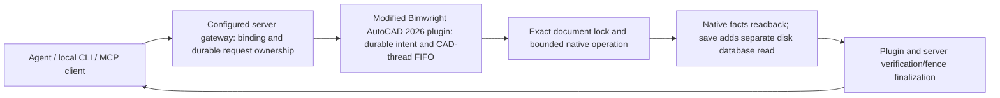

# Execution architecture

Current code is an integrated modified host, not a transport-agnostic middleware automatically governing other MCP servers. Native operations reuse Bimwright/AutoCAD primitives; Foundation supplies the surrounding identity, ownership, persistent intent, verification and finalization contract.

Execution effects and verification are separate facts. A request can be committed while verification is unknown. Query the original request; do not recreate objects, claim rollback after commit, or infer that a timeout means no effect. The server's persistent records and the plugin's intent journal have distinct roles; a client-side waiting deadline cannot cancel a synchronous CAD operation already running.

Existing-object changes require fresh digests in the bound session. Associated members are treated as a logical group. This is cooperative workflow protection, not an adversarial sandbox or a replacement for engineering review. Unrelated CAD tools have their own state; the project cannot silently supply a shared transaction for them.
