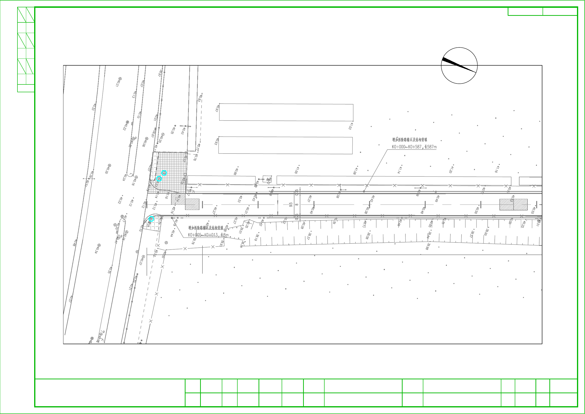
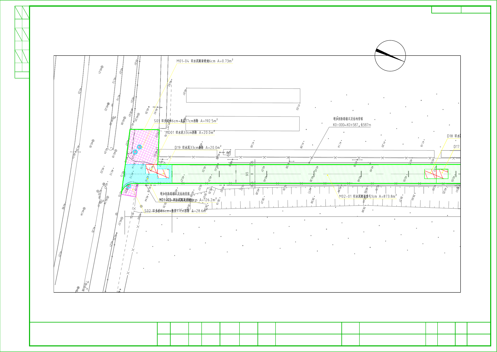
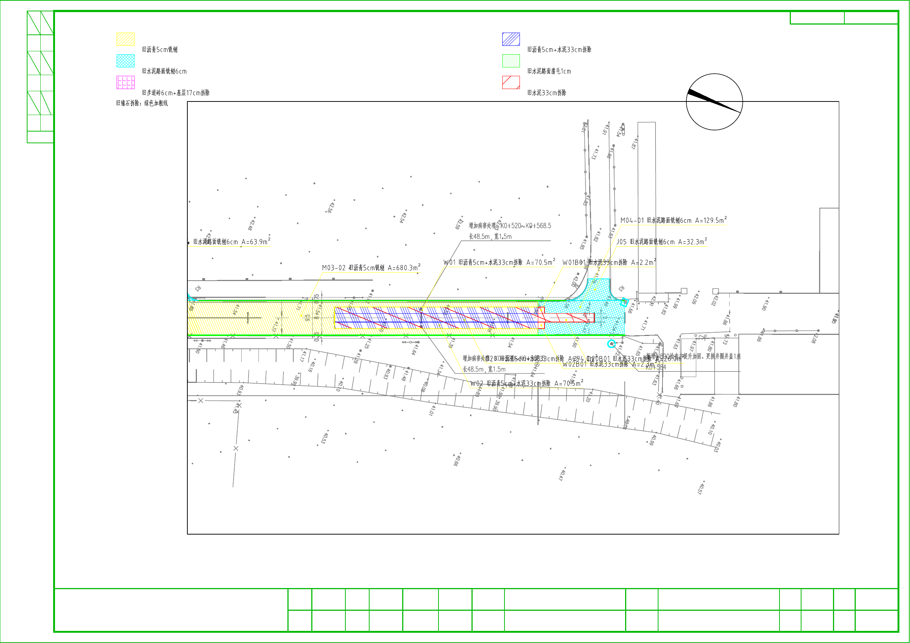

# Anonymous road demolition case

[中文](README.zh-CN.md) · [Before drawing](before.pdf) · [Annotated result](after.pdf) · [Quantity and station tables](quantities.pdf)

This historical companion-Skill case illustrates an existing drawing result. It is not a Foundation-only workflow certification or a new benchmark. The existing annotation workflow was not rerun for publication preparation.

## Required components, downloads and real backend

| Task | Required components | Versions and limits |
| --- | --- | --- |
| Supported basic CAD operations | `cad-agent-foundation` only | Local baseline `v1.0.0-local`; public source preview `v1.0.0-rc.2` (same runtime source), without a runnable binary asset. Bounded 2D operations; current writes require metres; recorded Windows/AutoCAD 2026 host only. Neither Skill is required. |
| This project's callout style and placement | Foundation + `cad-callout-pair-layout` | Public callout Skill v0.3.0-rc.1 (existing rules v0.3). Metre-based road defaults; complete styles and layout have not been certified on Foundation v1 alone. Check backend coverage before writing. |
| This project's distress/demolition workflow | Foundation + `cad-distress-annotation` + `cad-callout-pair-layout` | Public distress rules preview v0.1.0-rc.1. Requires engineering evidence, classifications and the callout rules; full workflow needs capabilities outside the current Foundation profile and is not certified on these three components alone. |

For this project's modular annotation rules, prepare the distress and callout Skills plus a verified native backend. Choose Foundation for its supported governed operations. See [component selection and installation](../../docs/COMPONENTS-AND-INSTALLATION.md). The three-repository combination does not make this entire historical case reproducible today.

Foundation source preview and **both independently published Skill previews**: [Foundation](https://github.com/capskov/cad-agent-foundation), [callout Skill](https://github.com/capskov/cad-callout-pair-layout), [distress Skill](https://github.com/capskov/cad-distress-annotation). Use the linked component installation guides and Skill Release ZIPs. The PDF/PNG links above provide display-only assets in this source preview; no CAD reproduction dataset or automatic installer has been released.

### Historical provenance versus current reproduction

The October 2026 result was created by project-specific Python/pywin32 scripts using **AutoCAD 2026 COM (`AutoCAD.Application.25.1`)**, with geometry planning using Shapely. Its placement stage imported the existing callout Skill's pure-geometry `pair_layout.solve`. Native project scripts created and inspected boundaries, fills, ordinary leaders and associated text and recorded handles/results. The distress rules were subsequently distilled into the Skill; the historical run is not evidence that today's three-component installation executed every step. It was not a Foundation-v1 `dwg_apply_plan` run and must not be confused with a separate earlier Bimwright code-execution evaluation.

Publication presentation edits likewise used an authorized native COM route on independent copies, a separate frame copy via ObjectDBX, native PDF plotting, and read-only spreadsheet extraction. They are presentation preparation, not a migration to Foundation.

| Workflow step | Historical/presentation backend | Current Foundation-v1 boundary |
| --- | --- | --- |
| Engineering scope, classification and quantity evidence | Project geometry plans / Python / Shapely and source tables; rules distilled into distress Skill | Domain rules belong to Skill; full geometry planning and Boolean/complex geometry not provided or end-to-end certified. |
| Boundaries and classified fills | Project-specific AutoCAD 2026 COM scripts and native readback | Some new-boundary/hatch primitives exist; this exact case has not been rerun through Foundation. |
| Text/dots/leaders and bounded placement | Native project scripts plus existing callout `pair_layout.solve` | Basic callout primitive exists; exact styles, separate colors/fonts and complete placement integration not certified. |
| External frame, final-page legend, layouts and plotting | Owned-copy COM/ObjectDBX/native plot during presentation preparation | External-reference editing, paper-space layouts and plotting are outside the current profile. |
| Quantity-table display | Read-only spreadsheet extraction and document rendering | Not a core CAD operation; supplied as visual references, not a recomputation. |

Exact automated reproduction still requires reviewed tools for the missing steps and a separately cleared CAD dataset. Those project helpers and raw DWGs are not included here. Verify and authorize any additional backend explicitly; do not switch providers to bypass an unknown write. These display downloads demonstrate the integrated workflow's output, not complete Foundation-first compatibility.

## Before and after

Existing drawing before the annotation work, page 1:

Existing annotated result, page 1:

The final printed page contains the complete new demolition legend:

Both drawing PDFs contain four pages. The underlying CAD layout has four sheet frames in one layout. The model-space demolition legend was removed from the demonstration copy and placed in the fourth frame's paper space. The frame remains an external reference in the local DWG working copies, using the relative path `case-frame.dwg`; it was not bound or exploded into the case drawing.

The title block's project/company/signature text and outlined lettering were cleared in an independent frame copy. Frame borders and grid lines remain. The blank superseded paper legend was removed from the display copies. No formal drawing or original frame was modified.

## Included quantity references

The three-page reference PDF contains the main engineering quantity table, the pavement quantity table, and the junction schedule. Station values, side markers, quantities and notes are retained. Names identifying the project were removed. Display formatting follows the source where applicable; values were not recomputed. Blank filler rows and scratch cells outside the official table content are omitted.

Pavement structure drawings, explanatory reports and other background documents are not included in this visual case.

## Evidence and limits

The existing 42 closed regions and associated fill areas were checked against the saved case record, within the agreed 0.001 m² area threshold. Presentation cleanup preserved model geometry handles; no new engineering scope, quantity fitting or full placement optimization was performed. Some existing dense/overlapping annotations remain for human review. The quantity tables are input references, not a claim that all map quantities reconcile to every table total.

The case uses the saved drawing on disk. Unsaved changes in the user's open formal drawing were left untouched. Drawing/source-table/frame hashes and the original open drawing's DBMOD were checked unchanged.

These publication drafts provide display PDFs and PNGs. Maps are flattened to remove hidden CAD layer metadata. Raw DWGs, real model-space coordinates, font assets and private provenance logs are not included in this public candidate directory. Local DWGs and the external frame remain separately available for maintainer review; a downloadable CAD dataset would need its own clearing step.

This display case does not extend the core release's advertised operation or unit support.
